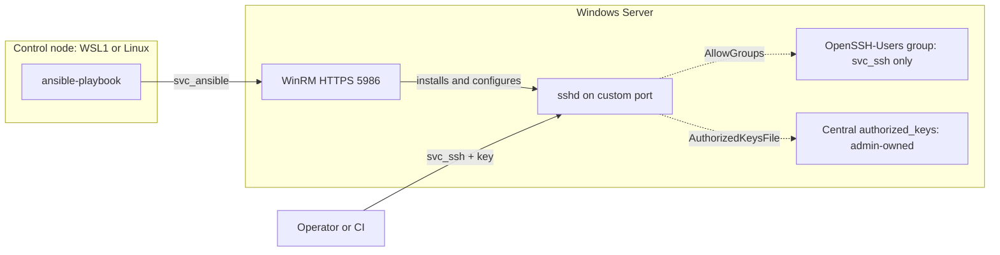

<div align="center">

# Windows OpenSSH Server · Ansible

**Hardened, auto-starting OpenSSH Server for Windows Server, on any port except 22, with least-privilege service accounts.**

[](https://docs.ansible.com/)
[](#requirements)
[](https://github.com/PowerShell/Win32-OpenSSH)
[](.ansible-lint)
[](LICENSE)

[Quick start](#quick-start) ·
[Installation](#installation) ·
[Configuration](#configuration) ·
[Testing](#testing) ·
[Troubleshooting](#troubleshooting)

</div>

---

## Table of contents

- [Overview](#overview)
- [Features](#features)
- [Architecture](#architecture)
- [Security model](#security-model)
- [Requirements](#requirements)
- [Quick start](#quick-start)
- [Installation](#installation)
  - [1. Prepare the Windows Server](#1-prepare-the-windows-server)
  - [2. Set up the control node](#2-set-up-the-control-node)
  - [3. Configure the project](#3-configure-the-project)
  - [4. Run the playbook](#4-run-the-playbook)
- [Configuration](#configuration)
- [Usage](#usage)
- [Testing](#testing)
- [Production checklist](#production-checklist)
- [Troubleshooting](#troubleshooting)
- [Project structure](#project-structure)
- [License](#license)

---

## Overview

This project installs and configures the **OpenSSH Server** that ships with
Windows Server. It enforces production best practices:

- **Custom port.** Port 22 is rejected, and so is any port that could be taken by another process before `sshd` starts at boot.
- **Autostart and self-healing.** The service starts automatically at boot and restarts itself after a crash.
- **Least privilege.** A dedicated, non-admin `svc_ssh` account is the only identity allowed in over SSH. Ansible connects as a dedicated `svc_ansible` account, never the built-in Administrator.
- **Safe changes.** Every config change is validated with `sshd -t`, health-checked, and **rolled back automatically** on failure.

---

## Features

| Area | What you get |
|---|---|
| **Port safety** | Rejects 22, reserved Windows ports, the OS dynamic (ephemeral) range, Hyper-V excluded ranges, and ports already in use |
| **Installation** | Windows Feature-on-Demand (run as SYSTEM), or an MSI fallback for offline hosts |
| **Autostart** | `sshd` start mode is **Automatic**, with SCM recovery (restart after 5s / 15s / 60s) |
| **Safe change** | Stage the config, validate with `sshd -t`, promote it with a backup, restart, and health-check. **Automatic rollback** on failure |
| **Hardening** | Modern ciphers/KEX/MACs, no DSA, `MaxAuthTries 3`, idle timeout, no forwarding, `VERBOSE` logging, legal banner |
| **Access control** | `AllowGroups` set to a group containing only the service account, `DenyGroups administrators`, and a central admin-owned key file |
| **Firewall** | Vendor TCP/22 rule disabled **before** `sshd` first starts. The managed rule is bound to `sshd.exe` and scoped by profile and remote IP |
| **Validation** | `argument_specs` type-checks every input. Preflight guards prevent lockout and misconfiguration |
| **Operations** | Idempotent, check-mode drift reports, batched rollout, a reboot-verification playbook |
| **Quality** | FQCN modules, role-prefixed variables, `ansible-lint` production profile |

---

## Architecture



**Role execution order**


---

## Security model

| Account | Purpose | Local admin | Logon rights | Created by |
|---|---|:---:|---|---|
| `svc_ansible` | Ansible manages the server over **WinRM** | **Yes** ¹ | Network (WinRM) only. Console and RDP **denied** | [`Enable-WinRMForAnsible.ps1`](scripts/Enable-WinRMForAnsible.ps1) |
| `svc_ssh` | The **only** identity allowed in over **SSH** | **No** (enforced) | SSH only. RDP **denied** | The `openssh` role |

¹ Windows offers no narrower delegation for DISM, service and firewall
management. The account is dedicated, can't log on interactively, and is
auditable on its own.

**SSH access controls**

- `AllowGroups openssh-users` and `DenyGroups administrators` in `sshd_config`.
- The `OpenSSH-Users` group membership is enforced as **exactly** `svc_ssh` (`state: pure`). Manual additions are reverted on the next run.
- The play fails if `svc_ssh` is a member of local Administrators.
- Keys live in `C:\ProgramData\ssh\service_account_authorized_keys` with an exact ACL: SYSTEM and Administrators have full control, `svc_ssh` has read-only access. Per-user `~/.ssh/authorized_keys` files are ignored.
- **Key-only** login by default. A preflight guard stops the run if no login method would remain.
- The play refuses to run as the built-in Administrator (RID 500).

> [!NOTE]
> **Domain environments:** set `openssh_service_account_type: domain` and
> `openssh_service_account_domain: CORP`, then pre-create `CORP\svc_ssh` as a standard user.
> For WinRM, run the bootstrap with `-ServiceAccount 'CORP\svc_ansible' -DomainAccount`
> and use `ansible_winrm_transport: kerberos`.

---

## Requirements

| Component | Requirement |
|---|---|
| **Target** | Windows Server 2019 (build 17763) or newer: 2019, 2022, 2025 |
| **Control node** | Linux or **WSL1**, Python 3.10+, `ansible-core >= 2.16`, `pywinrm` ([`requirements.txt`](requirements.txt)) |
| **Collections** | `ansible.windows`, `community.windows` ([`requirements.yml`](requirements.yml)) |
| **Network** | Control node → target **TCP 5986** (WinRM HTTPS). Clients → target **custom SSH port** (default 2222) |
| **Install source** | Windows Update / WSUS / FoD for the capability method, or the Win32-OpenSSH MSI |

> [!IMPORTANT]
> Ansible's control node **does not run natively on Windows**. Use
> [WSL1 on the Windows Server](#option-a-wsl1-on-windows-server) for a single-VM lab,
> or a separate [Linux VM](#option-b-linux-vm).

---

## Quick start

For experienced users. The full walkthrough is in [Installation](#installation).

```powershell
# On the Windows Server (elevated): create svc_ansible + WinRM HTTPS
.\scripts\Enable-WinRMForAnsible.ps1 -AllowedRemoteAddresses <CONTROLLER_IP>
```

```bash
# On the control node
pip install -r requirements.txt
ansible-galaxy collection install -r requirements.yml -p ./collections
cp group_vars/windows/vault.yml.example group_vars/windows/vault.yml && ansible-vault encrypt group_vars/windows/vault.yml
#   edit inventory/hosts.yml + add your public key to group_vars/windows/vars.yml
ansible-playbook enable_openssh.yml --ask-vault-pass
ssh -i ~/.ssh/<key> -p 2222 svc_ssh@<SERVER>
```

---

## Installation

### 1. Prepare the Windows Server

Copy the project to `C:\ansible-project`, then in an **elevated PowerShell**:

```powershell
Set-ExecutionPolicy -Scope Process Bypass -Force

# Creates svc_ansible (prompts for a 16+ character password), adds it to
# local Administrators, and enables WinRM over HTTPS.
C:\ansible-project\scripts\Enable-WinRMForAnsible.ps1 -AllowedRemoteAddresses <CONTROLLER_IP>

ipconfig                     # note the IPv4 address
Get-NetConnectionProfile     # note NetworkCategory (see Troubleshooting)
```

| Script option | Use |
|---|---|
| *(omit `-AllowedRemoteAddresses`)* | Lab shortcut: allows any address (prints a warning) |
| `-ServiceAccount 'CORP\svc_ansible' -DomainAccount` | Use an existing domain account |
| `-CertificateThumbprint <thumbprint>` | Bind a CA-issued certificate (production) |
| `-DisableHttpListener` | HTTPS-only WinRM (production) |

> [!IMPORTANT]
> Store the `svc_ansible` password in your password manager. It goes into
> `vault.yml` in step 3.

### 2. Set up the control node

#### Option A: WSL1 on Windows Server

Ansible runs inside Linux on the server itself and manages that same server
over WinRM. Use **WSL1**, because it needs **no nested virtualization** and **shares the
VM's network stack**.

| Windows Server | Build | WSL support | Path |
|---|---|---|---|
| 2019 | 17763 | WSL1 only, no `wsl --install` | **A1 → A3 → A4** |
| 2022 | 20348 | WSL1 + WSL2 | **A1 → A2 → A4** (A3 if A2 fails) |
| 2025 | 26100 | WSL1 + WSL2 | **A1 → A2 → A4** (A3 if A2 fails) |

Check your build: `(Get-CimInstance Win32_OperatingSystem) | Select-Object Caption, BuildNumber`

**A1. Enable the WSL feature** (all versions, elevated PowerShell)

```powershell
Enable-WindowsOptionalFeature -Online -FeatureName Microsoft-Windows-Subsystem-Linux -NoRestart
Restart-Computer
# after reboot - must print "Enabled"
(Get-WindowsOptionalFeature -Online -FeatureName Microsoft-Windows-Subsystem-Linux).State
```

**A2. Install Ubuntu with `wsl.exe`** (Server 2022 / 2025, internet access)

```powershell
wsl --set-default-version 1      # new distros use WSL1
wsl --install -d Ubuntu          # downloads, installs and launches Ubuntu
```

When it launches, create a **UNIX username and password**. They are separate
from Windows accounts and are used for `sudo`. If `wsl --install` prints its
help text, rejects an option, or fails to download, use **A3**.

<details>
<summary><b>A3. Manual install</b> (Server 2019, offline hosts, or if A2 fails)</summary>

<br>

Windows Server has no Microsoft Store, so download the Ubuntu package directly
and unpack it. For offline hosts, download the file elsewhere and copy it to
`C:\WSL\Ubuntu2204.appx`.

```powershell
# Elevated PowerShell
[Net.ServicePointManager]::SecurityProtocol = [Net.SecurityProtocolType]::Tls12
$ProgressPreference = 'SilentlyContinue'      # much faster downloads on PS 5.1

New-Item -ItemType Directory -Path C:\WSL -Force | Out-Null
Set-Location C:\WSL
Invoke-WebRequest -Uri https://aka.ms/wslubuntu2204 -OutFile Ubuntu2204.appx -UseBasicParsing

# The download is an app bundle: unpack it, then unpack the x64 package inside
Rename-Item .\Ubuntu2204.appx Ubuntu2204.zip
Expand-Archive .\Ubuntu2204.zip .\pkg -Force
$x64 = Get-ChildItem .\pkg -Filter '*x64*.appx' | Select-Object -First 1
if ($x64) {
    Copy-Item $x64.FullName .\x64.zip
    Expand-Archive .\x64.zip C:\WSL\Ubuntu2204 -Force
} else {
    Move-Item .\pkg C:\WSL\Ubuntu2204          # not a bundle: already the x64 package
}
Remove-Item .\Ubuntu2204.zip, .\x64.zip, .\pkg -Recurse -Force -ErrorAction SilentlyContinue

# First launch registers the distro, then prompts for a UNIX username/password
$exe = Get-ChildItem C:\WSL\Ubuntu2204 -Filter 'ubuntu*.exe' | Select-Object -First 1
& $exe.FullName
```

**Keep `C:\WSL\Ubuntu2204`.** The Linux filesystem lives there, so deleting it deletes the distro.

</details>

**A4. Verify WSL**

```powershell
wsl -l -v            # VERSION must be 1; convert with: wsl --set-version <NAME> 1
```

```text
  NAME            STATE           VERSION
* Ubuntu-22.04    Running         1
```

Open the Linux shell with `wsl`, then check connectivity:

```bash
ping -c 2 archive.ubuntu.com
timeout 3 bash -c '</dev/tcp/<VM_IP>/5986' && echo "WinRM reachable"
```

> [!TIP]
> With WSL1, traffic to the server's own IP is local and not filtered by Windows Firewall.
> `-AllowedRemoteAddresses` is optional for this single-VM setup. Use the VM's
> IP from `ipconfig` in `inventory/hosts.yml`. Ubuntu 22.04 ships Python 3.10,
> so `pip` selects ansible-core 2.17.x. That is expected.

<details>
<summary><b>Optional: WSL2 instead of WSL1</b></summary>

<br>

1. Enable nested virtualization on the **host** while the VM is off:
   - Hyper-V: `Set-VMProcessor -VMName <vm> -ExposeVirtualizationExtensions $true`
   - VMware: VM settings › CPU › *Virtualize Intel VT-x/EPT or AMD-V/RVI*
2. On the server: `Enable-WindowsOptionalFeature -Online -FeatureName VirtualMachinePlatform`, then reboot.
3. Run `wsl --set-default-version 2` before A2.

WSL2 uses NAT, so its traffic arrives through the `vEthernet (WSL)` adapter,
which is usually on the **Public** profile. Add `public` to
`openssh_firewall_profiles` or set `openssh_verify_from_controller: false`.

</details>

#### Option B: Linux VM

Any Ubuntu, Debian or RHEL-family VM that can reach the server on TCP 5986.

#### Install Ansible (both options)

```bash
sudo apt update && sudo apt install -y python3-venv      # dnf on RHEL
python3 -m venv ~/ansible-venv && source ~/ansible-venv/bin/activate

# Copy into your Linux home. Ansible ignores ansible.cfg in world-writable
# directories, and WSL's /mnt/c is world-writable.
cp -r /mnt/c/ansible-project ~/ansible-project    # or scp / git clone on Option B
cd ~/ansible-project

pip install -r requirements.txt
ansible-galaxy collection install -r requirements.yml -p ./collections
```

### 3. Configure the project

**Create the SSH key for `svc_ssh`** on the machine you will SSH **from**
(Windows 10/11 already includes `ssh-keygen`):

```bash
ssh-keygen -t ed25519 -C "svc_ssh@winsrv01" -f ~/.ssh/svc_ssh_winsrv01
cat ~/.ssh/svc_ssh_winsrv01.pub      # copy this single line
```

**Edit the project files** on the control node:

| File | Set |
|---|---|
| [`inventory/hosts.yml`](inventory/hosts.yml) | `ansible_host`: server IP or DNS name |
| [`group_vars/windows/vars.yml`](group_vars/windows/vars.yml) | `openssh_service_account_public_keys`: paste the public key |
| `group_vars/windows/vault.yml` | `svc_ansible` password (step 1) and a new random `svc_ssh` password |

```bash
cp group_vars/windows/vault.yml.example group_vars/windows/vault.yml
nano group_vars/windows/vault.yml
ansible-vault encrypt group_vars/windows/vault.yml
```

> [!TIP]
> Generate the `svc_ssh` password with `openssl rand -base64 32`. Windows requires a
> password for local accounts, but it is never used for SSH while password authentication is off.

### 4. Run the playbook

```bash
ansible windows -m ansible.windows.win_ping --ask-vault-pass      # expect "pong"
ansible-playbook enable_openssh.yml --syntax-check
ansible-lint
ansible-playbook enable_openssh.yml --ask-vault-pass               # apply
ansible-playbook enable_openssh.yml --ask-vault-pass               # second run: changed=0
```

---

## Configuration

All variables are type-checked by [`argument_specs.yml`](roles/openssh/meta/argument_specs.yml).
The full list with comments is in [`roles/openssh/defaults/main.yml`](roles/openssh/defaults/main.yml).

<details open>
<summary><b>Core settings</b></summary>

| Variable | Default | Description |
|---|---|---|
| `openssh_port` | `2222` | SSH listen port. Never 22 |
| `openssh_service_start_mode` | `auto` | `auto` or `delayed` start at boot |
| `openssh_install_method` | `capability` | `capability` (FoD) or `msi` |
| `openssh_listen_addresses` | `[]` | Bind addresses. Empty = all interfaces |
| `openssh_default_shell` | PowerShell | SSH session shell. `''` = cmd.exe |
| `openssh_banner_text` | legal notice | Pre-auth banner. `''` disables it |

</details>

<details open>
<summary><b>Service account &amp; authentication</b></summary>

| Variable | Default | Description |
|---|---|---|
| `openssh_service_account_type` | `local` | `local` (created by the role) or `domain` (pre-existing) |
| `openssh_service_account_name` | `svc_ssh` | Account name |
| `openssh_service_account_domain` | `''` | NetBIOS domain when `type: domain` |
| `openssh_service_account_password` | vault | Local account password |
| `openssh_service_account_public_keys` | `[]` | Authorized public keys. `from="..."` options supported |
| `openssh_service_account_update_password` | `on_create` | `always` to rotate |
| `openssh_password_authentication` | `false` | Key-only login by default |
| `openssh_access_group` | `OpenSSH-Users` | Exclusive SSH access group |
| `openssh_deny_administrators` | `true` | `DenyGroups administrators` |

</details>

<details>
<summary><b>Firewall, WinRM account &amp; rollout</b></summary>

| Variable | Default | Description |
|---|---|---|
| `openssh_firewall_profiles` | `[domain, private]` | Firewall profiles for the SSH rule |
| `openssh_firewall_remote_ips` | `any` | Allowed source IPs/CIDRs. **Restrict in production** |
| `openssh_disable_default_port22_rule` | `true` | Disable vendor TCP/22 rules |
| `openssh_verify_from_controller` | `true` | Check the SSH banner from the control node |
| `winrm_service_account_forbid_builtin_admin` | `true` | Refuse to run as RID-500 Administrator |
| `winrm_service_account_deny_interactive_logon` | `true` | Deny console logon for `svc_ansible` |
| `winrm_service_account_deny_rdp_logon` | `true` | Deny RDP logon for `svc_ansible` |
| `openssh_batch_size` *(play)* | `100%` | `serial` batch size for fleet rollouts |

</details>

---

## Usage

```bash
# Apply
ansible-playbook enable_openssh.yml --ask-vault-pass

# Drift report: no changes made (hosts with OpenSSH already installed)
ansible-playbook enable_openssh.yml --ask-vault-pass --check --diff

# Fleet rollout in 10% batches; stops on the first failed batch
ansible-playbook enable_openssh.yml --ask-vault-pass -e openssh_batch_size=10%

# Reboot one host at a time and prove sshd auto-starts
ansible-playbook verify_openssh.yml --ask-vault-pass
```

| Tag | Runs |
|---|---|
| `openssh` | Everything in the `openssh` role |
| `openssh_preflight` | Validation and guards only |
| `openssh_install` | Install OpenSSH Server |
| `openssh_accounts` | Service account, access group, key file |
| `openssh_firewall` | Firewall rules |
| `openssh_config` | Host keys, banner, shell, `sshd_config` |
| `openssh_service` | Autostart, recovery, restart with rollback |
| `openssh_verify` | Post-deployment checks |

---

## Testing

> [!IMPORTANT]
> Run the SSH tests from a **different machine** than the server. Traffic from the server
> to itself (including WSL1) bypasses Windows Firewall, so it can't prove the firewall rules work.

| # | Test | How | Expected |
|:-:|---|---|---|
| 1 | Playbook succeeds | `ansible-playbook enable_openssh.yml` | `failed=0`; summary prints the ssh command |
| 2 | Idempotent | Re-run | `changed=0` |
| 3 | Key login | `ssh -i ~/.ssh/svc_ssh_winsrv01 -p 2222 svc_ssh@<IP>` | Banner, then a PowerShell prompt |
| 4 | Not admin | In session: `whoami /groups \| findstr /i S-1-5-32-544` | No output |
| 5 | Admins denied | `ssh -p 2222 Administrator@<IP>` | `Permission denied` |
| 6 | No passwords | `ssh -o PubkeyAuthentication=no -p 2222 svc_ssh@<IP>` | `Permission denied (publickey)` |
| 7 | Port 22 closed | `ssh -p 22 svc_ssh@<IP>` | Refused / timeout |
| 8 | Autostart | `ansible-playbook verify_openssh.yml` | `PASS ... sshd auto-started` |
| 9 | Crash recovery | `Stop-Process -Name sshd -Force`, wait 5s, then `Get-Service sshd` | `Running` |
| 10 | Group drift reverted | `Add-LocalGroupMember OpenSSH-Users -Member Administrator`, re-run | Group contains only `svc_ssh` |
| 11 | No RDP | RDP as `svc_ansible` / `svc_ssh` | Sign-in method not allowed |
| 12 | Port 22 guard | `-e openssh_port=22` | Preflight: "must NOT be 22" |
| 13 | Lockout guard | `-e '{"openssh_service_account_public_keys": []}'` | Preflight: "No usable login method" |
| 14 | Rollback | `-e '{"openssh_listen_addresses": ["10.255.255.1"]}'` | Previous config restored; play fails cleanly |
| 15 | RID-500 blocked | `vault_ansible_user: Administrator` | "connected as the built-in Administrator" |

<details>
<summary><b>On-box verification commands</b> (PowerShell on the server)</summary>

<br>

```powershell
Get-Service sshd | Select-Object Status, StartType                  # Running / Automatic
sc.exe qfailure sshd                                                # RESTART actions
Get-LocalGroupMember OpenSSH-Users                                  # only svc_ssh
Get-LocalUser svc_ssh, svc_ansible | Select-Object Name, Enabled, PasswordExpires
icacls C:\ProgramData\ssh\service_account_authorized_keys           # SYSTEM/Admins F, svc_ssh R
Get-NetTCPConnection -State Listen -LocalPort 2222                  # sshd listening
Get-NetFirewallRule -Group 'OpenSSH Server (Ansible)' | Get-NetFirewallPortFilter
& "$env:windir\System32\OpenSSH\sshd.exe" -T | Select-String '^(port|allowgroups|denygroups|passwordauthentication) '
```

</details>

---

## Production checklist

- [ ] Inventory uses **DNS names** and WinRM uses a **CA-issued certificate**. Remove the lab `ansible_winrm_server_cert_validation: ignore` from `hosts.yml`
- [ ] Use **domain service accounts + Kerberos**. This also avoids `LocalAccountTokenFilterPolicy=1`, which local-account mode requires
- [ ] Bootstrap with `-AllowedRemoteAddresses <controller IPs>` and `-DisableHttpListener`
- [ ] Restrict `openssh_firewall_remote_ips` to admin / jump-host networks
- [ ] Keep `openssh_password_authentication: false`. Pin key sources with `from="..."`
- [ ] Keep `vault.yml` encrypted. Rotate with `openssh_service_account_update_password: always` and by re-running the bootstrap
- [ ] Forward the **OpenSSH/Operational** event log to your SIEM (`VERBOSE` records key fingerprints)
- [ ] Schedule `--check --diff` runs to detect drift
- [ ] Disable or rename the built-in Administrator through your GPO baseline. The playbook doesn't do it, to avoid a console lockout

---

## Troubleshooting

<details>
<summary><b>WinRM / connectivity</b></summary>

<br>

| Symptom | Resolution |
|---|---|
| `win_ping`: `401` / access denied as `svc_ansible` | Local mode needs `LocalAccountTokenFilterPolicy=1`; re-run the bootstrap. Check membership: `Get-LocalGroupMember -SID S-1-5-32-544` |
| `win_ping`: certificate verify failed | Lab: keep `ansible_winrm_server_cert_validation: ignore` on the host. Production: set `ansible_winrm_ca_trust_path` and connect by DNS name |
| `win_ping` times out | Run `Test-NetConnection <IP> -Port 5986`. Check `-AllowedRemoteAddresses` includes the controller |
| Ansible ignores `ansible.cfg` | The project is in a world-writable directory (such as `/mnt/c`). Copy it to `~/` |

</details>

<details>
<summary><b>OpenSSH / playbook</b></summary>

<br>

| Symptom | Resolution |
|---|---|
| `win_user` fails creating `svc_ssh` | The password violates local policy. Use 24+ random characters |
| `Add-WindowsCapability` fails (0x800f0954 / 0x8024402c) | Windows Update or WSUS is unreachable. Use `openssh_install_method: msi` with a local or UNC `openssh_msi_url` |
| "TCP/2222 is unsafe ... excluded range" | Hyper-V/WinNAT reserved the port. Pick another (`netsh int ipv4 show excludedportrange protocol=tcp`) |
| Warning about the **public** profile | `Set-NetConnectionProfile -InterfaceAlias 'Ethernet' -NetworkCategory Private`, or add `public` to `openssh_firewall_profiles` |
| `Permission denied (publickey)` for `svc_ssh` | Check that the key is in `openssh_service_account_public_keys` and that you used `-i`. See Event Viewer › OpenSSH › Operational |
| Domain account "not found" | Pre-create it in AD and set `openssh_service_account_domain` (NetBIOS) |
| "sshd did not come up ... Previous config restored" | The live config was rolled back. Fix the variable reported in the error and re-run |

</details>

<details>
<summary><b>WSL</b></summary>

<br>

| Symptom | Resolution |
|---|---|
| `WslRegisterDistribution failed with error: 0x8007019e` | The WSL feature isn't enabled or a reboot is pending. Redo **A1** |
| `0x80370102` / "enable the Virtual Machine Platform" | The distro is trying to use WSL2. Run `wsl --set-default-version 1`, then `wsl --set-version <NAME> 1` |
| `wsl --install` prints help / "invalid command line option" | Older built-in `wsl.exe`. Use **A3** |
| `apt update` can't resolve hosts | Write a `nameserver` line to `/etc/resolv.conf`, set `[network]` / `generateResolvConf = false` in `/etc/wsl.conf`, then run `wsl --shutdown` |
| `pip install` fails building `cryptography` / `krb5` | `sudo apt install -y build-essential python3-dev libffi-dev libkrb5-dev` |

</details>

---

## Project structure

```text
ansible-project/
├── ansible.cfg
├── LICENSE                          # MIT
├── requirements.yml                 # Ansible collections (pinned ranges)
├── requirements.txt                 # control node Python packages (pinned ranges)
├── .ansible-lint                    # lint profile: production
├── enable_openssh.yml               # main playbook
├── verify_openssh.yml               # reboot + autostart verification
├── inventory/
│   └── hosts.yml
├── group_vars/windows/
│   ├── vars.yml                     # WinRM connection, service accounts, options
│   └── vault.yml.example            # copy to vault.yml and encrypt
├── roles/
│   ├── winrm_service_account/       # blocks RID-500, denies console/RDP logon
│   └── openssh/
│       ├── defaults/main.yml        # every tunable
│       ├── meta/                    # galaxy info + argument_specs
│       ├── tasks/                   # preflight, install, accounts, firewall,
│       │                            # configure, service, verify
│       └── templates/sshd_config.j2
└── scripts/
    └── Enable-WinRMForAnsible.ps1   # one-time target bootstrap
```

---

## License

Released under the **MIT License**. See [`LICENSE`](LICENSE) for the full text.

<div align="center">
<sub>Maintained by Byte Tech Solutions</sub>
</div>
